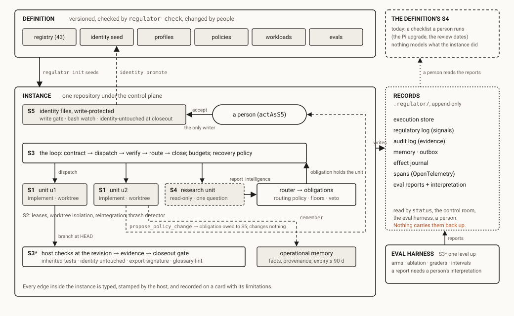

# Harness² read through the control plane

- **Status:** open. The component's name is decided (§7); the rest is design.
- **Source:** *Harness²: Recursive Agent Harnessing for an Open World*, Xu et al., Google
  Cloud AI Research and Northwestern, [arXiv 2610.14224](https://arxiv.org/abs/2610.14224)
  (9 Oct 2026), the code at
  [google-research/harness2](https://github.com/google-research/harness2) (Apache 2.0),
  and the [project page](https://harness2.github.io/). Read from the HTML version of the
  paper, the README and the page; the summary of the release that prompted the read is
  [a post by Akshay Pachaar](https://x.com/akshay_pachaar/status/2111753928031531232)
  (18 Oct 2026), which also quotes his own June article on Comet's Opik and Ollie.
- **Why a note:** the paper is the first well-measured system in which the harness edits
  itself, and it edits exactly the files this project holds under S5, a profile grant or
  a check. It is the strongest case so far for one of the things `AGENTS.md` defers,
  autonomous mutation of the definition, and it comes with the regressions that are the
  reason for deferring it. Both halves are worth having on the record, and the method
  has three pieces regulator could take without giving up the boundary.

Claims about what Harness² does cite the paper. Claims about what regulator does cite the
file. The gap between the two is the point.

## 1. What Harness² is

An agent is a frozen model plus an editable harness. The harness is eight component
files, grouped by role: system prompt, guardrails, memory and skills (context
construction); tool guidance and scripts (tool interface); subagents (orchestration);
plugins (middleware). *Harnessing* is editing those files while the weights stay fixed.
The problem the paper sets itself is the open world: the task was unseen when the harness
was designed, and there is no ground-truth verifier online to say whether an edit helped.

Two recursion levels answer it.

**Task-level recursion: Propose, Probe, Compose.** The current harness runs once on the
task, giving a reference trajectory and deliverable. An *editor* (Claude Opus 4.8 in the
main experiments; the executors are Gemini 3.5 Flash and GLM-5 under OpenCode or Codex)
reads the task, the harness, the reference, the history and the improvement library, and
drafts two candidate harnesses: an *invariant* edit aimed at a weakness that recurs
across domains (planning, tool use, context, delegation) and a *domain-specific* edit
aimed at this task's procedures and constraints. Every edit must trace to a moment in the
trajectory; `KEEP_BASE` is a valid answer. Each candidate is *probed*: run on the same
task under the same settings, and its trajectory and deliverable are compared with the
reference. That comparison is the *behavioural contrast*, and it is the only signal: no
label, no score. A *composer* then reads the reference, the candidates, their diffs and
the contrasts and may merge supported edits, revise conflicting ones, adopt one, or keep
the base, citing a concrete observation for each decision. The composed harness runs and
delivers. With a budget `k > 1`, candidates run in parallel (wider) or the step repeats
with the refined harness carried forward (deeper), and a *selector* picks among
anonymized deliverables without seeing which harness made them. The paper calls the
result adoption, not verified optimality.

**Harnessing-level recursion: the improvement library.** After each task a *reflector*
reviews the whole record. A lesson is kept only if an execution contrast supports it;
having been selected is not enough. A library entry is an executable harness plus an
`EXPERIENCE.md` (the situation it applies to, the lessons, the evidence) under an index.
The next task starts again from the base harness; the library is consulted by the
editor in Propose, so components are reused by proposal, never inherited. The library
starts empty per benchmark.

**What it reports.** One step improves every one of four model-and-substrate pairs on
three professional benchmarks: up to +11.5 on WorkBuddy-Bench (GLM-5, OpenCode), +4.5 on
JobBench, +11.8 percentage points on LAB's partial pass rate. On WorkBuddy with Gemini
3.5 Flash the base scores 72.4, one step 77.5, and `k = 5` 80.8, against 73.4 for
ReasoningBank, 75.3 for Harness Scaling and 76.4 for Meta-Harness. Ablating skills costs
the most on code and web tasks, ablating scripts the most on office tasks. A harness
refined for Gemini 3.5 Flash transfers unchanged to GLM-5 and to Opus 4.8 with gains that
vary widely.

**What it concedes.** Appendix F: the loop costs extra executions and editor sessions,
and the signal is behavioural contrast under execution noise and *shared model bias*, so
it guarantees neither correctness nor transfer. Appendix E.6 sorts nine regressions into
three kinds: the selector preferring a narrower deliverable, a *false premise propagated
across candidates* (a wrong assumption adopted once becomes the premise of every later
candidate, at a cost of 2 to 11 points), and noisy attribution. The safeguards are mostly
prompt-level: no grader, rubric or score in any context; files under the context
directory are to be treated as data; the editor does not execute scripts it finds in a
candidate; a validator rejects harnesses with unnamed skills, template braces or missing
scripts; rollouts are capped. There is no reward-hacking analysis. The README's security
note says executor network access is unrestricted and Codex runs with its sandbox off,
and warns that public benchmark rubrics are reachable online.

**What the post flattens.** The post's summary is accurate as far as it goes; three things
are lost. "Turn any harness into a self-improving system" is a claim about two substrates
and an eight-file component model. "No grader or correct answer" is true of the online
loop and not of the numbers: the gains are measured by the benchmarks' graders, and the
editor is a stronger model than either executor, so part of what the harness "learns" is
a stronger model's judgment written into the weaker model's files. And what persists is
not a better harness but a library the next task may draw on; the base harness is reset
every time, and the recursion's increments shrink. The second half of the post is an
advertisement for Opik's Ollie, whose loop (a production trace becomes a diagnosis, a
proposed fix the user approves, and a regression test that is kept) is, as it happens,
closer to this project's posture than Harness² is: a person approves, and the thing kept
is a host-run test.

## 2. The same object, two questions

Harness² and regulator act on the same object, the set of files around a model, and ask
different questions of it. Harness² asks how the harness gets *better at the task*.
regulator asks how the harness *stays inside its boundaries* while it works, and how
anyone would know (`vsm/IDENTITY.md`, "Purpose"). Each has, by design, what the other
lacks: Harness² has a learning loop over the harness and no S5, no S3\* independent of a
model, and no path to a person; regulator has all three and no learning loop over the
definition at all. The definition changes only when a person accepts a proposal
(`regulator identity accept`, `docs/concepts/identity.md`, "The only way to change
identity") and carries it back to the seed (`identity promote`), and the eval harness
measures the regulators, not task performance (`docs/concepts/evidence-about-the-regulators.md`).

Piece by piece:

| Harness² | VSM function | regulator's nearest thing | The difference |
| --- | --- | --- | --- |
| The base harness: eight component files | the definition | the definition: registry, profiles, policies, workloads, identity, evals (`docs/concepts/definition-and-instance.md`) | Harness² edits all eight per task. regulator versions and checks them (`regulator check`) and changes them by decision |
| *Guardrails*, an editable component | S5 | `regulator/identity/`, write-protected by four layers and INV-001 | This is the one component regulator would never hand to the loop. In Harness² the agent rewrites its own guardrails per task |
| *Skills*, *scripts*, *plugins*, *subagents* | S1 profile, S2, the host | profile grants over tool effects (`packages/regulator/profiles/`); the trust rule, under which a project's skills, extensions and prompt templates never configure a unit's session (`project-trust-rule`); unit types declared in the workload | In Harness² the editor writes scripts and skills the executor then runs, with unrestricted network. That is a control channel opened from inside the loop; the paper's mitigations are a validator and a prompt instruction |
| *System prompt*, *tool guidance*, *memory* | advice | identity rendered into context (level 5), `contract-advice`, `remember` | The same level in both systems. Here the two systems agree: this is where a loop may edit |
| The editor proposes two candidates with evidence | S4 → S5 | `propose_policy_change`: a typed proposal that changes nothing and opens an obligation owed to S5 (INV-002; `packages/core/src/obligations.ts`) | Harness² has no S5. The composer adopts. In this project's terms, *proposal is policy* in Harness² |
| Probe: run the candidates, compare trajectories | evidence | host-run checks at a revision; deterministic graders over the stores | Harness²'s evidence is a model's reading of a trajectory, and the paper names the shared-bias problem. Under INV-003 and INV-004 that reading is self-report, not audit |
| Compose: adopt, merge, revise or keep, citing an observation | the decision | the eval report's `interpretation`, by a named person, which must say where the gated arm lost; retirement written on the card by a person | Harness² keeps the discipline (a cited observation, `KEEP_BASE`, downside weighed as heavily as upside) and gives the decision to a model |
| The selector over anonymized deliverables | S3 close | the closeout gate: technical verdict, then human acceptance, kept separate | Harness² closes on a model's choice among outputs |
| The improvement library: harness + `EXPERIENCE.md` + evidence | S4's model, operational memory | `remember`: a fact with host-stamped provenance, a required expiry of at most 90 days, a scope, retraction by a named person (`memory-store` card) | A lesson in Harness² has evidence and no expiry, no owner, no review date, no retraction. The paper's future work, "revising outdated experience", is the memory-store card's failure class, *memory-becomes-policy*, and in Harness² a lesson *is* an edit to the harness, so the failure is the design |
| Recursion budget `--k` | budget | the budget policy, metered per attempt (`budget-guard`) | Alike. Harness² counts total tokens; its Pareto analysis is the honest row |
| "Recursion" | VSM recursion | the *missing recursion* pathology: the harness regulated as a viable system of its own, with owners, review dates and retirement (`regulator-lifecycle`, `doctor`) | Harness²'s recursion is optimization recursion. The harness is tuned as a parameter vector; nothing regulates it as a system |

## 3. Harness² against the pathology catalog

Read as an arrangement rather than a method, Harness² exhibits several rows of
`docs/PATHOLOGIES.md` by construction. This is not a complaint about the paper, which is
a benchmark result and says what it does not guarantee; it is what the catalog is for.

- **No S3\***. The composer and selector judge the executor's trajectories, and the paper
  says the signals "are sensitive to shared model biases". Anonymized selection and the
  hidden rubric help; they do not make the judge independent of the judged.
- **S5 collapsed into S3**. The system prompt and the guardrails are rewritten by the
  loop, so identity is whatever the last composition wrote. The *propagated false
  premise* regression is this pathology measured: a wrong assumption adopted once
  becomes the premise of every later candidate.
- **Memory becomes policy**. By design: a lesson is kept as an executable harness.
- **Data absorbed as control**. `EXPERIENCE.md` and the harness files are the model's
  output and its next input. The defence, "treat files under the context directory as
  data", is a prompt instruction, the lowest mechanism level.
- **Missing recursion**. No library entry has an owner, a review date or a retirement
  condition; nothing in the loop can ask a person, and the whole thing is benchmark-bound.

And two rows it does *not* exhibit, which regulator should notice:

- **Feedback delay**, in the form this project's thesis is about: Harness² measures the
  effect of every change it adopts, on the task, before the next task. regulator measures
  the regulators under a drift suite and has never measured a change to a profile's
  advice or a contract's advice at all. The definition is versioned and checked; it is
  not evaluated.
- **No S4**. Harness² has a model of "what worked, in what situation, on what evidence"
  that is consulted before each task. regulator's S4 is "an interrupt with a hold, not a
  cache" ([open questions §4](2026-09-25-open-questions.md#4-predictive-intelligence-s4-as-a-model-of-outside-and-then)),
  and the predictive note is exploratory.

## 4. What regulator could take, at the mechanism level

Each item is proposed against a seam that exists. None of them lets a model write a
definition file.

1. **A harness-edit proposal kind.** The Propose step produces exactly what
   `propose_policy_change` carries: a change, a reason and the evidence. A proposal
   whose payload is a diff against an advice-level definition file (a profile's advice,
   a contract's advice, a skill the workload declares) plus the trajectory moment it
   traces to, routed as every proposal is (an obligation owed to S5), and accepted by a
   person with the `identity accept` command generalized to the definition's advice
   files. Level 3 (typed tool and schema) and level 2 (the router). This is the proposal
   half of Harness² with the adoption half left where INV-002 puts it. The editor is a
   `research`-type unit under a read-only profile; it needs nothing it does not already
   have (`packages/regulator/profiles/research.json`).

2. **Probe as an eval arm.** Harness² runs a candidate before adopting it. The eval
   harness already runs arms over a suite with deterministic graders and declared
   metrics, and an arm may differ in extensions, checks and identity
   (`packages/regulator/evals/drift.json`). Let an arm also differ in an advice file, and
   a proposed edit can be run as an arm against the workload's fixture before a person
   decides: Probe with the suite's graders instead of a model's reading, and the
   interpretation rule instead of the composer. This is the pre-merge trial (DEBT row 37)
   for the definition rather than the domain. It is also the one place regulator could
   answer Harness²'s open-world problem on its own terms: where there is a fixture,
   probe against it; where there is none, the proposal waits for a person, and the
   obligation says so.

3. **Lessons go to memory or to a proposal, never to the harness.** If a reflector is
   ever built, its output is one of two records that already exist: `remember`, when the
   lesson is a fact for later units (advice, expiring, scoped, retractable), or a
   proposal, when it is a rule. Harness² has one discipline here regulator lacks and
   should adopt as a schema field: a lesson must cite an execution contrast. A `remember`
   entry and a proposal could be required to cite an observation the host can resolve, a
   unit and a revision, the way an authority reference must resolve to an invariant that
   exists (DEBT row 10, paid). The host cannot check that the fact is true (the
   `memory-store` card's first limitation); it can check that the evidence points at
   something.

4. **The library is an instrument, not a regulator.** Harness²'s leave-one-out analysis
   (the score with the library versus without it) is the calibration report the
   instrument record kind in [open questions §4](2026-09-25-open-questions.md#4-predictive-intelligence-s4-as-a-model-of-outside-and-then)
   would require. If regulator grows an experience store, it gets an instrument card:
   the quantity it estimates (that adopting this advice improves this metric), the level
   (model-judgment, the weakest), the metric it is graded on and the report that last
   graded it; and `regulator check` refuses it without one.

5. **The accept paths, written down.** Harness²'s eight components are all editable by
   its loop. Here every definition file is *proposable*, because INV-002 already makes a
   proposal change nothing, and identity is proposed that way today through
   `propose_policy_change`. What differs per file is the path an accepted proposal
   takes, and `BOUNDARY.md` should say it. Identity lands only through `identity
   accept`. An advice file (the system prompt's advice, tool guidance, contract advice,
   skills, memory) lands through `definition accept` after its probe. Anything that
   executes or grants (a unit type, which is a profile, a grant, a budget and a route;
   the profile grants; the host checks; extensions under the trust rule) lands as a
   unit of work against the definition's repository under a contract, verified by
   `regulator check` and the tests at closeout, merged by a person. So the reflector may
   propose a new kind of unit and how it joins the workload; it may not author the code
   or the grant the proposal becomes. The line Harness² crosses is not proposing a
   subagent or a script. It is the editor writing the script and the executor running
   it in the same step, with nothing between.

## 5. The experiment the two projects suggest together

regulator's one experiment asks whether regulation slows architectural drift. Harness²
is its mirror: a loop that improves task score by editing the harness, with regressions
of 2 to 11 points from a false premise that propagated. Those regressions are drift,
measured on task score instead of on boundaries. The experiment both projects suggest
is to run a Propose-Probe-Compose step over the advice files of the software workload,
under the drift suite, with the regulators ablated versus enabled, and ask two
questions the paper could not: whether the gates catch a propagated false premise
before it lands (the write gate and the trust rule should refuse an edit to a guardrail
or a script outright; the proposal path should hold one to an advice file until a person
looks), and what the regulators cost in the task-score gain Harness² reports. That is a
live-model experiment and waits on the first live report
([#46](https://github.com/MetaCoding-io/regulator/issues/46)) like the predictive note
does.

Until then, Harness² joins GSD-Pi as comparison material: not a harness to integrate
with, but another system's answer to the same question, with the answer measured.

## 6. Next step

Item 1 is the slice with a seam ready for it: a `harness-edit` proposal payload in the
protocol, routed as a proposal, with a `definition accept` path that writes an advice
file under S5 authority the way `identity accept` writes an identity file. It needs a
design decision first on which definition files count as advice (item 5), recorded on
`BOUNDARY.md`. Items 2 to 4 wait on #46. §7 names the component and draws the level it
belongs to.

## 7. The reflector: S4 of the level above

### Is this second-order cybernetics?

The phrase appears nowhere in this repository or the course, and the thing it names is
already here under Beer's word for it. Second-order cybernetics is the cybernetics of
observing systems: the observer is inside the loop, and the system that regulates
becomes the object of regulation. The course's primer says it as recursion running
upward ("the harness is an S1 unit of the team that operates it", §7), lesson 14 applies
the evidence rule "one recursion level up", and the registry's lifecycle (owner, review
date, ablation switch, retirement condition on every card) is a regulator regulating the
regulators. The pathology catalog names the absence as *missing recursion*. So the
second-order observer exists. It is a person reading a table of numbers under the
interpretation rule. Harness² is the same move with the model as the observer and
nothing above it, which is what its propagated-false-premise regressions measure: an
observer with no observer.

### Is "analyze the past and propose updates" S4?

In three parts, on three functions. *What happened* is S3\*: the stores, the audit log,
the eval reports, all of which exist. *What it means for how the system should behave*
is S4 in Beer's strict sense, since S4 carries "a model of the whole system in its
environment" and not only a scan of the outside; nothing holds that model here today.
*Whether to change* is S5: `identity accept`, a person. Harness²'s reflector collapses
the three into one editor call.

The recursion level matters. The S4 the instance has (`research` units,
`report_intelligence`, `intelligence-intake`) scans the *repository's* environment. A
component that reads an *instance's* past and proposes changes to the *definition* is
the S4 of the level above, where the operations are instances and the domain is the
definition's files. `docs/PATHOLOGIES.md` already names that gap on the missing-recursion
row: "the definition's own S4 (the Pi upgrade path) is a checklist a person runs."

### What S4 is today, and every note that widens it

One intake, one producer, one effect: a `research` unit under the read-only
`intelligence` profile, dispatched by S3 under its own contract, budget and route, calls
`report_intelligence`; the router derives severity under policy, opens one obligation
per affected unit, vetoes dispatch and close at `blocking`, notes an expired finding and
never re-raises it (`packages/core/src/obligations.ts`). It is demand-triggered only. The
`intelligence-intake` card's own retirement condition is a second intake.

The notes that widen it, in order of age: the archived `DESIGN-ROADMAP.md` C2 ("S4
operating model": demand-triggered research from obligations, freshness, aggregation of
recurring uncertainty, when intelligence should propose an S5 change rather than inform
S3); the archived `REGULATORY-STATE-AND-ROUTING.md` (a refresh obligation when stale
intelligence is relied on, time-triggered refresh); [open questions
§2](2026-09-25-open-questions.md#2-a-person-should-be-able-to-create-s4-intelligence)
(a person as a sensor; sensors declared in the definition); [open questions
§4](2026-09-25-open-questions.md#4-predictive-intelligence-s4-as-a-model-of-outside-and-then)
(predictions that resolve; the instrument record kind); the [ArticleMiner
note](2026-09-25-articleminer-knowledge-production.md) (S4 for parser and model drift,
"S4 proposes a change, S5 accepts it"); and §4 of this note. Every one of them widens S4
along one of three axes: who may be a sensor (unit, person, watcher, schedule), what it
models (the environment, the instance's own future, the definition), and what it emits
(a signal, a prediction, a proposal). None widens the consumer. It is always an
obligation owed to S3 or a proposal owed to S5, and that is the invariant the reflector
keeps.

### The component

It is the shape of `checks`: a package that reads what the instance writes and emits
typed records, with the loop never depending on it.

- **Reads** the execution store, the regulatory and audit logs, the memory store, the
  eval reports and the span projection, all append-only.
- **Emits** three record kinds that exist (`intelligence-signal`, `remember`,
  `policy-proposal`) plus the `harness-edit` proposal kind of §4. It never writes a
  definition file; `identity accept` and its `definition accept` sibling stay the only
  writers, so INV-001 and INV-002 hold without a new mechanism.
- **Depends on** `protocol`, `core` and the `status` read model. Nothing depends on it,
  the posture `control-room` has.
- **Runs** either as a CLI over a repository of instances or as a `reflect` unit inside
  an instance, which gives it a contract, a budget, a lease and a profile. The primer's
  rule applies: give it those and it is a unit, give it a prompt and it is a paragraph.
- **Is registered as an instrument, not a regulator** (open questions §4), graded on
  calibration: did the proposals a person accepted move the metric they named?
  `regulator check` refuses it without that report. Harness²'s leave-one-out library
  analysis is the shape of the report.
- **Hazard for the card:** a loop that reads the instance's trace and feeds the instance
  can oscillate and can be self-fulfilling (§4's hazards, one level up), so its output
  is advice with a horizon, probed as an eval arm where a fixture exists and held for a
  person where none does.

**Decided (2026-10-18).** The component is the **reflector**; the unit type is `reflect`
and the package is `packages/reflector`. Not "improver": that names an outcome nobody has
measured, and the card must be able to say "did not improve" without contradicting
itself (Harness²'s own improver made nine tasks worse). "Reflector" names what it does,
reading the whole record, pairs with `research` and `intelligence` one level down, and is
Harness²'s word for the same component, which helps a reader of both. "Proposer" is the
fallback; "intelligence" is right in Beer's terms and already taken by the instance-level
profile. Neither word is on the identity glossary's refused list.

**Corrected (2026-10-18).** An earlier version of item 5 and of figure 2 sorted the
definition's files into *never editable*, *proposable* and *declared, not learned*, with
unit types and extensions in the last set. That conflated who may ask with who may
write. A new unit type, and how it joins the workload, is a legitimate proposal; what it
cannot be is a file a person copies into place, because it is a grant and code. The
split is now by accept path, as item 5 says, and figure 2's S5 box says the same.

### The two levels, drawn

Hand-drawn, light theme, in the course's figure vocabulary; the research directory is not
built into the docs site, so these are not subject to the generator rule of [open
questions §1](2026-09-25-open-questions.md#1-the-control-room-should-show-how-the-declared-system-connects).
When the level above is built, the generator reproduces these from the definition and
these files become history.

*Figure 1 — before. One recursion level is regulated. The level above has people for
S3, S3\* and S5, and a checklist for S4. The records flow out and are read for status,
evals and audit; no mechanism carries what they say back up.*

*Figure 2 — after. Four things are new: the reflector, its read of the records, the
`harness-edit` proposal kind, and an eval arm that may differ in an advice file.
Everything it emits lands in a record kind that exists, and every write to the
definition still goes through a person.*

What changes, at its mechanism level and seam:

| Change | Level | Seam | Refuses |
| --- | --- | --- | --- |
| The accept-path split on `BOUNDARY.md` (§4, item 5) | 2, definition check | `regulator check` over the registry and the instance manifest | a `harness-edit` against a file outside the advice set; it is routed as a plain proposal instead |
| `harness-edit` proposal kind, carrying a diagnosis, a change and a prediction (§8) | 3, typed tool and schema | `packages/protocol`; routed by `routeMessages` like every proposal | a proposal whose observation (unit, revision, moment) does not resolve, or whose prediction names no metric, baseline, horizon or disconfirming value |
| Probe as an eval arm | 2, deterministic graders | `evals/*.json`: an arm gains an `advice` field | adoption from a report without an interpretation |
| `regulator definition accept` | 2, authority check then the write | beside `identity accept`; disposition authority per person | any file but an advice file |
| Instrument record kind | 2, registry check | `packages/regulator/registry/`, a second record kind beside regulators | an instrument without a calibration report |
| `packages/reflector` | 4, model judgment | reads `.regulator/` and the reports; depends on `protocol` and `core` | dispatching, dispositioning, writing under `regulator/`: it has no tool that does |

Order: the boundary split first, because every other row names it. The probe arm and the
instrument card wait on the first live eval report (#46), since a calibration report
needs live numbers to calibrate against.

## 8. Three records: what was seen, what is expected, what was decided

A reader of §4 and §7 (via a second model asked to review them) put two objections that
the schema sketch had not met. First: observed evidence, predicted effects and
authoritative decisions are three different records, and a trace that supports a
*diagnosis* is not evidence that the proposed *remedy* will work; the distinction
belongs in the schemas, not the narrative. Second: every reflector proposal should state
the counterfactual it is betting on, that is, what measurable outcome it expects,
relative to what baseline, over what horizon, and which observation would count against
it. Both are right, and both land on seams that exist. What they expose is a gap in the
`harness-edit` proposal as §4 specified it.

### What the protocol already keeps apart

Two of the three records exist, and the rule that separates them is already written.

- **Observed evidence** is an `EvidenceRecord` (`packages/protocol/src/audit.ts`): a
  host check's observation bound to a unit, an attempt, a revision, an environment and
  the criteria it speaks to, produced by S3\*. The identity glossary says the rest: a
  unit's report is a claim, not evidence. An `IntelligenceSignal` keeps `claim` and
  `observation` as separate fields for the same reason, with `evidence[]` as references.
- **Authoritative decisions** are events: an obligation's disposition with its `--by`
  and rationale (`packages/core/src/obligations.ts`), an identity decision
  (`regulator identity accept | reject`), a recovery decision under the versioned
  policy. Each names who decided and cites what it decided on.
- **Predicted effects** have no record kind. [Open questions
  §4](2026-09-25-open-questions.md#4-predictive-intelligence-s4-as-a-model-of-outside-and-then)
  designs one: a prediction is an intelligence signal whose claim is about the future,
  with a `horizon` (when it resolves), a `confidence` that is a probability, and the
  evidence it was computed from; when the unit closes or aborts, the loop records the
  outcome against every open prediction that named it, and the resolved pair
  (probability, outcome) is regulatory state like an evidence record.

So the first objection asks for §4's record to exist, and for the proposal schema to
reference it rather than fold it into `rationale`.

### The gap in the `harness-edit` proposal

As §4 specified it, a `harness-edit` carries the diagnosis (the trajectory moment the
edit traces to) and the change (the diff), and nothing else. That is Harness²'s shape,
and it is how Harness²'s worst regression happens: a trace that justified a diagnosis
is read as evidence that the remedy works, the remedy is adopted, and the false premise
propagates into every later candidate at a cost of 2 to 11 points (the paper's Appendix
E.6). The calibration question §7 gave the instrument card, *did the proposals a person
accepted move the metric they named*, presupposes a named metric that the schema never
asked for. The second objection supplies the missing field.

`PolicyProposalSchema` today is an envelope, a `rationale`, a `requestedChange` of
unknown shape and `evidence[]` references. A `harness-edit` is a `requestedChange` with
three parts, each a different record:

| Part | What it holds | What it is evidence of |
| --- | --- | --- |
| **Diagnosis** | references to the observations the edit traces to: a unit, a revision, the moment in the trajectory, and the evidence records or signals read there | that something happened. Nothing more |
| **Change** | the diff against one advice file in the proposable set (§4 item 5) | nothing. It is the thing being asked for |
| **Prediction** | a §4 prediction record: `metric`, one of the fifteen names in `EVAL_METRICS`; `baseline`, a committed report's fingerprint or the arm the probe runs against; `direction` and `magnitude`; two `horizon`s (below); and `disconfirmedBy`, the grader value at the horizon that counts against it | nothing yet. It is a bet that resolves |

The host refuses a `harness-edit` whose diagnosis references do not resolve (the rule
§4 already states), and one whose prediction is missing any of its parts. A proposal
without a prediction is still a legal `policy-proposal`; it is simply not a
`harness-edit`, and it cannot be probed, because there is nothing to probe against.

### Two horizons, and what resolution does

An advice edit has two horizons, and the prediction names both.

1. **The probe horizon** is the eval arm of §4 item 2, run before anyone decides. The
   arm's report resolves it: the metric at the baseline's fingerprint against the metric
   under the edit, with the interval the harness already computes.
2. **The live horizon** is the next N units of the named types after acceptance, which
   is when the effect matters. It stays open after the decision. The loop resolves it
   the way §4 resolves any prediction, from the stores, with the same graders.

Resolution is three-valued, because the baseline problem is real now: at three
repetitions few intervals separate, and the live report (#46) is still owed. A
prediction resolves as *confirmed*, *disconfirmed* or *inconclusive*. Inconclusive is
not neutral. It counts against the prediction's precision (the effect was too small to
see at the budget the probe had), never for the edit; Harness²'s composer treats a
single-rollout effect the same way, as noise. A disconfirmed live horizon opens an
obligation owed to S5 to revert or re-decide, which is the loop the reflector otherwise
lacks: its own output becomes auditable by the graders that audit everything else.

The chain for one proposal is then five records, no two of the same kind: a diagnosis
(evidence records and signals), a change (the diff), a prediction (a record that
resolves), a decision (the obligation's disposition, citing the prediction's id), and a
resolution (a grader's observation at each horizon). The instrument card's calibration
report (§7) is nothing more than the set of resolved predictions.

### Where this sits in the architecture

This is not a new rule. It is the eval harness's pre-registration rule
([evidence about the regulators](../concepts/evidence-about-the-regulators.md): a suite
states what it will measure before it is run, so a report cannot choose afterwards the
metric that happened to look good) applied one level down, to one proposal instead of
one suite. The disconfirming value is the interpretation rule's "where the gated arm
lost", asked in advance instead of after.

It may also deserve stating beside INV-003 as a candidate invariant, since INV-003 is
the same shape one function over: *evidence for a proposal's diagnosis does not satisfy
its effect; the effect is a prediction that resolves.* Whether it is an invariant or a
schema rule is a decision for when the prediction record lands; the note records the
candidate so it is not re-derived.

**Decided (2026-10-18).** The `harness-edit` proposal carries three parts, diagnosis,
change and prediction, and the prediction is the record open questions §4 designs, not a
field of its own. The change table in §7 says so. The prediction record therefore moves
ahead of the reflector in the build order: it is the second slice after the accept-path
split, since the probe arm (§4 item 2) has nothing to resolve without it.
